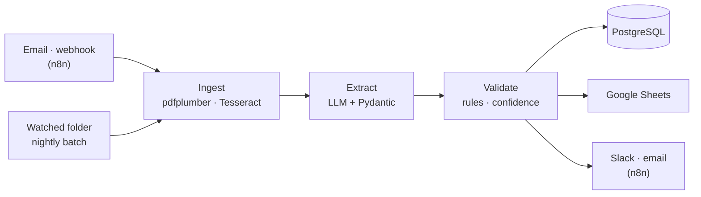

# DocFlow

[](https://github.com/PriyamKeshri/Docflow/actions/workflows/ci.yml)

An automated document-intake pipeline. Invoices, bank statements and resumes arrive by
email, webhook or a watched folder. DocFlow extracts structured fields with an LLM, checks
them against business rules, stores them in PostgreSQL and Google Sheets, and posts a
summary to Slack or email. It runs unattended, retries its own failures every night, and
comes with an evaluation harness that measures field-level accuracy, latency and cost per
document.



## How it works

| Stage | What happens |
| --- | --- |
| **Trigger** | n8n listens on a webhook and an IMAP inbox and forwards each attachment to the API. A watcher service polls `data/inbox`. A GitHub Actions cron starts the nightly batch. |
| **Ingest** | File type is detected from its bytes. Text PDFs go through pdfplumber; pages without a text layer are rasterised and read with Tesseract, page by page, keeping Tesseract's word confidence. |
| **Extract** | A single structured-output call (Claude or Gemini) classifies the document and returns its fields as JSON that must match a Pydantic schema. An invalid answer is retried once with the validation errors. |
| **Validate** | Totals, balances, dates and required fields are checked. Validation errors, low model confidence or poor OCR send the document to human review. |
| **Store** | Each document is a PostgreSQL row (SQLAlchemy) holding the extracted data, issues, confidence, tokens, cost and latency. Accepted and approved documents are appended to Google Sheets. |
| **Notify** | The API sends events to an n8n workflow that posts to Slack and emails failures. A batch sends one summary rather than one message per file. |
| **Evaluate** | `docflow eval` runs the same code path over a labelled dataset and reports accuracy, latency, cost, and how well the review flag catches mistakes. |

### Extracted fields

| Type | Fields |
| --- | --- |
| Invoice | number, vendor (name, address, tax id), customer (name, address), issue and due dates, currency, subtotal, discount, tax, shipping, total, payment terms, line items |
| Bank statement | bank, account holder, last 4 digits of the account, period, currency, opening and closing balance, total credits and debits, transactions with running balance |
| Resume | name, email, phone, location, skills, experience, education |

Anything else is classified as `other` and sent to review.

### Validation and review

| Check | Severity |
| --- | --- |
| Required fields present; dates are valid | error |
| Invoice: line items add up to the subtotal; subtotal − discount + tax + shipping = total | error |
| Statement: opening balance + transactions = closing balance; period start before end | error |
| Invoice: quantity × unit price per line, due date after issue date, tax-inclusive totals | warning |
| Statement: running balances, credit and debit totals, transaction dates within the period | warning |
| Resume: email and phone format, experience dates in order | warning |

A document's confidence is the lowest model confidence among its required fields, scaled
down when OCR quality is poor. It goes to review (`needs_review`) when any error fires or
its confidence is below the threshold (0.80 by default); otherwise it is `accepted`.
Reviewers approve or reject it through the API, optionally with corrected fields, which are
validated against the same schema and stored alongside the original extraction.

## Quick start

### Docker Compose

```bash
cp .env.example .env   # add your LLM API key, DOCFLOW_API_KEY, N8N_ENCRYPTION_KEY, SLACK_WEBHOOK_URL
make up                # API on :8000, n8n on :5678, PostgreSQL, folder watcher
make n8n-import        # imports the workflows (inactive)
```

In n8n at http://localhost:5678, activate **DocFlow Notify** (add an SMTP credential for
failure emails), then **DocFlow Intake** (add an IMAP credential, or remove the email
trigger to use only the webhook). Then send a document:

```bash
curl -F "file=@eval/dataset/docs/inv-02.pdf" http://localhost:5678/webhook/docflow-intake
cp eval/dataset/docs/bank-01.pdf data/inbox/
```

### Local

Requires Python 3.11+ and Tesseract (`brew install tesseract` or `apt install tesseract-ocr`).

```bash
make install
export DOCFLOW_DATABASE_URL=sqlite:///./docflow.db ANTHROPIC_API_KEY=...
.venv/bin/docflow process eval/dataset/docs/inv-01.pdf --show-data
.venv/bin/docflow serve   # interactive docs at http://localhost:8000/docs
```

Set `DOCFLOW_LLM_PROVIDER=fake` to run the whole pipeline without an API key; every
document then goes to review.

## API

All `/v1` routes require an `X-API-Key` header.

| Method | Path | Purpose |
| --- | --- | --- |
| `GET` | `/health` | Database status, provider and model |
| `POST` | `/v1/documents` | Upload a file (`file`, optional `doc_type` hint and `source`). Re-uploading the same bytes returns the existing record |
| `GET` | `/v1/documents` | List, filtered by `status` and `doc_type` |
| `GET` | `/v1/documents/{id}` | Extracted data, issues, field confidence, cost and latency |
| `POST` | `/v1/documents/{id}/review` | Approve or reject, optionally with `corrected_data` |
| `POST` | `/v1/documents/{id}/reprocess` | Run the stored original through the pipeline again |
| `POST` | `/v1/batch/run` | Process the inbox, retry failures, finish pending Sheets exports |
| `GET` | `/v1/reports/summary` | Counts, cost, latency, failures and review queue for the last N hours |

```bash
curl -H "X-API-Key: $DOCFLOW_API_KEY" -F "file=@invoice.pdf" http://localhost:8000/v1/documents
```

## Configuration

Settings are environment variables; [`.env.example`](.env.example) lists all of them.

| Variable | Default | Notes |
| --- | --- | --- |
| `DOCFLOW_LLM_PROVIDER` | `claude` | `claude`, `gemini` or `fake` |
| `DOCFLOW_CLAUDE_MODEL` / `DOCFLOW_GEMINI_MODEL` | `claude-opus-5-5` / `gemini-2.5-flash` | |
| `DOCFLOW_DATABASE_URL` | `sqlite:///./docflow.db` | `DATABASE_URL` is also accepted |
| `DOCFLOW_API_KEY` | unset | Required header value for `/v1` routes |
| `DOCFLOW_REVIEW_CONFIDENCE_THRESHOLD` | `0.80` | |
| `DOCFLOW_NOTIFY_WEBHOOK_URL` | unset | The n8n notify webhook |
| `DOCFLOW_NOTIFY_ON` | `issues` | `all`, `issues` or `none` |
| `DOCFLOW_SHEETS_ENABLED` | `false` | Also set the spreadsheet id and a service-account key |

## Evaluation

```bash
make eval   # runs the labelled set against the real API and updates the table below
```

<!-- EVAL:START -->
_No results yet: run `make eval` to fill in this section._
<!-- EVAL:END -->

- **Field-level accuracy** is the share of labelled fields extracted correctly, including
  fields that should be empty. A list such as line items counts only if every item matches.
- **Latency** is ingest plus extraction time per document; **cost** comes from the token
  counts returned by the API.
- **Flagged when wrong** is the share of documents with at least one wrong field that were
  sent to review; **flagged when right** is the share of fully correct documents sent there
  anyway.

`docflow eval` also takes `--model`, `--effort`, `--type` and `--limit`, and keeps every run
in `eval/results/runs/` so models can be compared.

### Dataset

[`eval/dataset`](eval/dataset) holds 38 labelled documents: 14 invoices, 12 bank statements
and 12 resumes in US, UK, German and Indian formats. Twelve are degraded scans that go
through OCR, two statements span two pages, two invoices carry a wrong printed total that
validation should catch, and one resume hides a prompt-injection line.

They are generated by [`eval/generate_dataset.py`](eval/generate_dataset.py), so the labels
are exact and contain no real personal data. To add real documents:

```bash
.venv/bin/docflow label path/to/document.pdf
```

This copies the file into the dataset and writes a draft label from the model. Correct
every field by hand, set `"verified": true`, and use `docflow eval --verified-only` to
score only checked labels.

## Deployment

**Linux VM.** Put `DOCFLOW_DOMAIN` and `N8N_DOMAIN` in `.env`, point both at the VM, and run
`make up-prod`. The production overlay adds Caddy for HTTPS and exposes only ports 80 and 443.

**Render.** [`render.yaml`](render.yaml) deploys the API with managed PostgreSQL and a
persistent disk. Run n8n separately and set `DOCFLOW_NOTIFY_WEBHOOK_URL` to its notify webhook.

**Nightly batch.** [`nightly.yml`](.github/workflows/nightly.yml) calls `/v1/batch/run` at
02:00 UTC using the `DOCFLOW_API_URL` and `DOCFLOW_API_KEY` repository secrets. If the API
isn't reachable from the internet, activate the **DocFlow Nightly Batch** n8n workflow instead.

## Development

```bash
make test   # pytest, no network access needed
make lint   # ruff
```

CI runs ruff and the test suite against PostgreSQL with Tesseract installed on every push,
then builds the Docker image. Model calls are replaced by fakes in tests.

## Design notes

- **OCR before the LLM.** pdfplumber and Tesseract are cheap and deterministic, the text is
  stored for re-runs, and OCR confidence feeds the review decision.
- **One call, typed output.** Every schema field is required but nullable, so the model
  decides on each one. Dates and amounts are normalised by Pydantic, so an odd value
  becomes a review issue instead of a lost document.
- **Arithmetic over self-reported confidence.** Totals and balances catch the misread digit
  or flipped sign that a model reports with high confidence.
- **Idempotent intake.** Files are keyed by SHA-256, so a document arriving by both email
  and webhook is processed once, and originals are kept for retries.
- **Untrusted input.** Document text is delimited and the model is told to ignore
  instructions inside it; Sheets rows are written as raw values to prevent formula
  injection; only the last four digits of account numbers are stored.

## Limitations

- Tables are created on start-up; add Alembic migrations before changing the schema.
- Extraction runs inside the request. Higher volumes need a job queue.
- Stored originals and extracted text can contain personal data and need a retention policy.

## Project layout

```
src/docflow/       API, pipeline, ingest, extractors, schemas, validation, storage, notifications
  evaluation/      eval runner, scoring and report
eval/              dataset generator and labelled dataset
n8n/workflows/     intake, notify and nightly batch workflows
deploy/            production Compose overlay and Caddyfile
tests/             unit and integration tests
```
